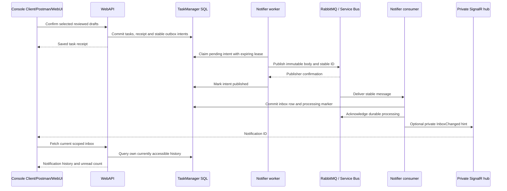
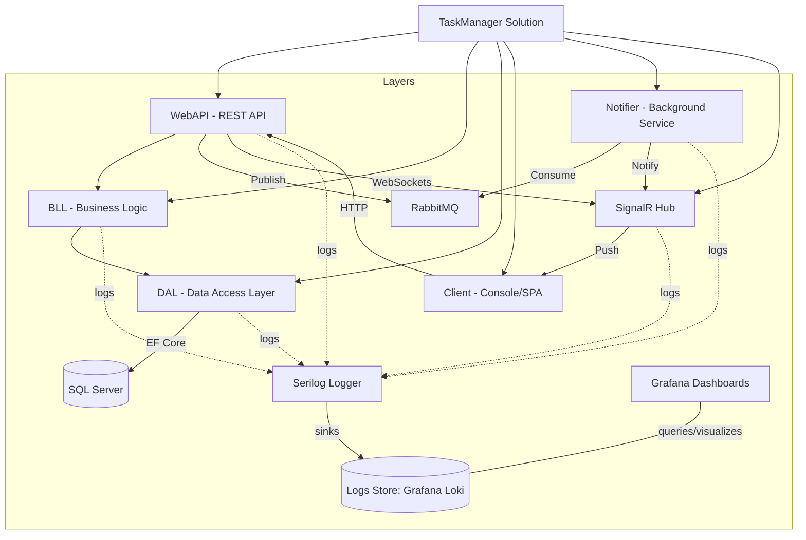
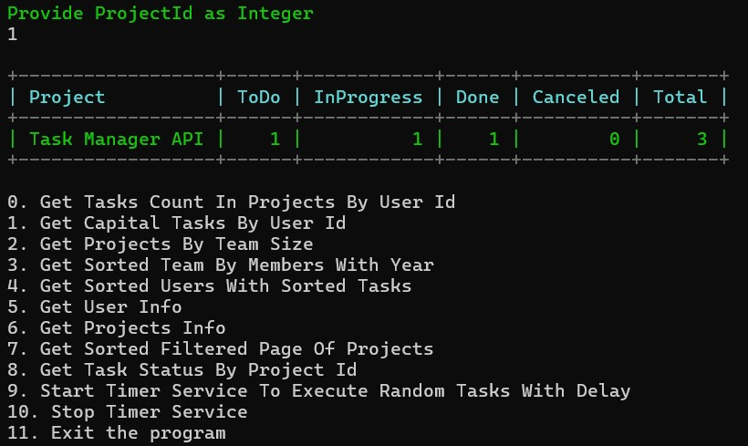
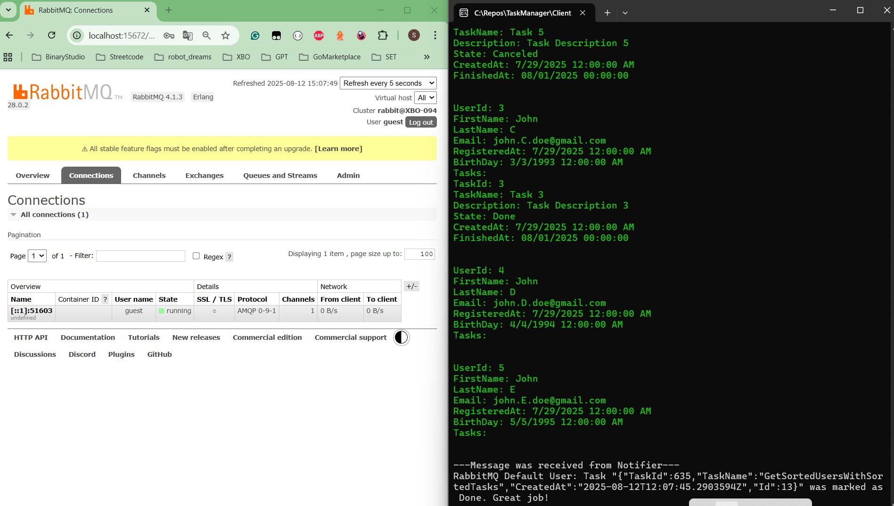
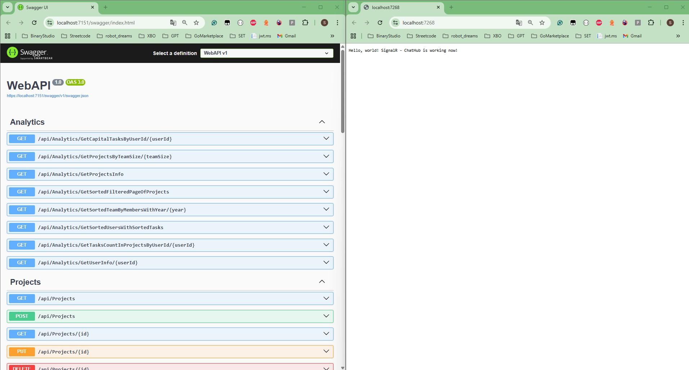
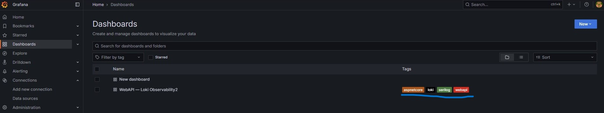
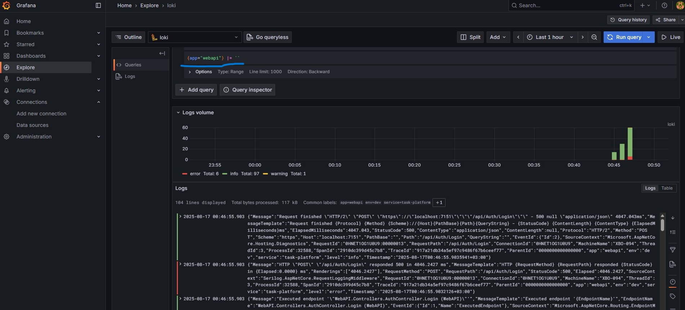
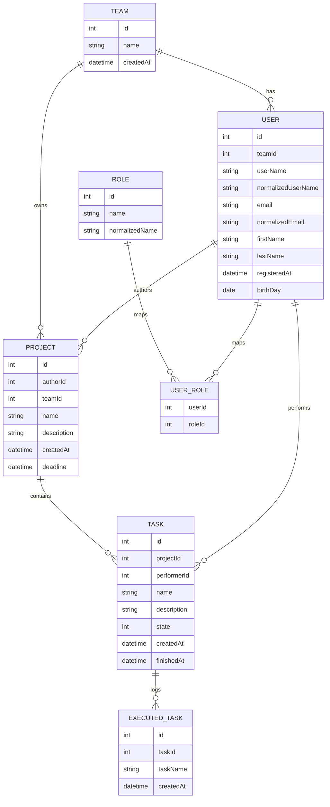

# 📝 TaskManager


**TaskManager** is a multi-component project management and task tracking system built with **.NET 10**, **SignalR**, **RabbitMQ**, **Serilog**, and a layered architecture (**BLL**, **DAL**, **WebAPI**, **Client**, **Notifier**).  
The browser application uses Ukrainian React/TypeScript screens and a separate
ASP.NET Core YARP web host. Identity cookies, confirmed email and server-side
team/project permissions protect browser operations; the existing JWT console
client remains supported.

## Notes to reviewed tasks

Open **AI нотатки**, choose an accessible project and the notes' date/time zone,
then request proposals. Review the quoted source, choose an allowed assignee,
edit each proposal and explicitly select the rows to save. Suggestions and
unresolved people/deadlines require human review. Extraction creates only a
private expiring draft; confirmation atomically creates tasks, materialization
links, an idempotency receipt and pending notification outbox entries.

AI defaults to unavailable, with manual task creation available. Configure a real
Azure OpenAI deployment through [AI provider settings](docs/ai-provider.md).
The separate [30-case evaluation runner](evaluation/task-extraction/README.md)
requires explicit live opt-in and token/cost limits; fixture tests are not model
quality measurements.

The authoritative implementation status is [AI/plan.md](AI/plan.md), with exact
verification results in [AI/traces](AI/traces). The durable notification inbox and
worker adapters are undergoing step26 acceptance. Azure provisioning and the
full-stack acceptance gate follow the active roadmap.

## Private notification history

Open **Сповіщення** to read your current task notifications, filter unread items
and mark them as read. Counts come from the scoped server inbox. Refresh and
reconnect retrieve the saved history; logging out clears the browser snapshot
and stops its realtime connection.

The Notifier runtime owns reminder scans, outbox dispatch and retention cleanup.
It commits a notification and its unique processing marker before broker ACK.
SignalR carries only a private change hint; the SQL inbox is the history source.
Local delivery uses RabbitMQ; deployed Azure delivery explicitly selects the
managed identity Service Bus and Azure SignalR adapters. See
[delivery guarantees and configuration](docs/notifications.md) for retry/DLQ,
retention, compatibility and verification boundaries.

---

## 🚀 Main Features
- **Project and Task Management**
  - Provide Analytics about projects: analyze tasks, examine team structure, investigate projects, measure user performance, compare teams and participants
  - Create, update, and delete projects, tasks, users, and teams
  - Link tasks to projects and users
  - Auth
- **SignalR Integration**
  - Instant real-time messages between the server and clients
- **RabbitMQ Messaging**
  - Asynchronous communication between services
- **Layered Architecture**
  - **BLL** (Business Logic Layer)
  - **DAL** (Data Access Layer)
  - **WebAPI** (REST API)
  - **Client** (Console client application)
  - **Notifier** (Notification service)
  - **AI** (Directory contains all AI Governance & Context Engineering artifacts)
- **Scalability**
  - Can be deployed locally, in Docker or in any cloud provider
  - Supports SQL Server or you can switch to your DB provider

---

## 🛠 Technology Stack
- **.NET 10**
- **C#**
- **Entity Framework Core**
- **SignalR**
- **RabbitMQ**
- **SQL Server**
- **Serilog**
- **Docker** (optional)

---

## 📊 Main types of Code Coverage
- **Line coverage** — what % of lines of code were executed by tests.
- **Statement coverage** — what % of instructions/operators were executed.
- **Branch coverage** — what % of condition branches (`if/else`, `switch`, `case`) were passed.
- **Condition coverage** — whether individual Boolean conditions were checked inside complex expressions.
- **Functions and Methods coverage** — what % of methods or functions were called by tests.
- **Path coverage** — what % of possible code execution paths were passed.

---

## 📦 Sequence Diagram


## 📦 Project Structure


## Local Docker setup

Use Docker with Compose v2 and Linux x86-64 containers. From PowerShell in the
repository root:

```powershell
./scripts/local-init.ps1
./scripts/local-up.ps1
./scripts/local-smoke.ps1
```

The init script generates private local credentials in ignored `.env`. Compose
builds non-root .NET 10 application images, applies a migration bundle before API
startup, and exposes the API at `http://localhost:8080` and the Notifier hub at
`http://localhost:8081/chathub`. Bootstrap admin is disabled by default.
`./scripts/local-down.ps1` stops services and retains data volumes. See
[local development](docs/local-development.md) for the optional console profile,
configuration and upgrade notes. Container execution was not verified in the
implementation environment because Docker was unavailable.

## Run from the .NET SDK

Install SQL Server and RabbitMQ (or run them via Docker)

Configure connection strings in appsettings.json for WebAPI and Notifier

Bootstrap administration is disabled by default. Register and confirm ordinary
accounts using the local email sink. An operator can explicitly enable the
development bootstrap with an email and a private strong password, then disable
it. Production does not automatically seed administrators or demo passwords.
Configure `Jwt__Key`, SQL, `BrowserAuth__PublicOrigin`, email and persistent keys
as described in [authentication and access](docs/authentication-and-access.md).

Run the following commands in the projects root:

```bash
dotnet run --project WebAPI
dotnet run --project Notifier
dotnet run --project Client
```

Use the console client to interact with the system

Also, you can use Swagger, Postman or any other client to execute Web API requests 

0. Get Tasks Count In Projects By User Id
1. Get Capital Tasks By User Id
2. Get Projects By Team Size
3. Get Sorted Team By Members With Year
4. Get Sorted Users With Sorted Tasks
5. Get User Info
6. Get Projects Info
7. Get Sorted Filtered Page Of Projects
8. Get Tasks Status By Project User Id
9. Start Timer Service To Execute Random Tasks With a Delay
10. Stop Timer Service
11. Exit the program











---
## 🛢️ Database Diagram



---

## 📘 AI System Overview

TaskManager is fully integrated with an **AI Governance & Context Engineering System**
based on the **ACE-FCA (Advanced Context Engineering — Frequent Compaction Approach)** standard.

This framework ensures that all AI-assisted and automated development remains  
**structured, reproducible, transparent, and human-reviewable**.

---

### 🧠 Core AI Artifacts (`/AI`)

| File / Folder | Purpose |
|----------------|----------|
| [`AI/README.md`](./AI/README.md) | Overview of AI governance logic and workflow phases. |
| [`AI/AGENTS.md`](./AI/AGENTS.md) | Rules for AI context management and compaction policy. |
| [`AI/AI_GUIDE.md`](./AI/AI_GUIDE.md) | Integration manual for AI assistants, Copilot, and CI tools. |
| [`AI/plan.md`](./AI/plan.md) | Active roadmap of AI-driven development steps. |
| [`AI/research.md`](./AI/research.md) | Technical findings and contextual data for planning. |
| [`AI/decisions.md`](./AI/decisions.md) | Architecture Decision Records (ADRs). |
| [`AI/traces/`](./AI/traces/) | Historical logs of all AI actions and completed steps. |

---

### ⚙️ GitHub Automation (`/.github`)

| File / Workflow | Description |
|------------------|-------------|
| [`ABOUT.md`](./.github/ABOUT.md) | GitHub-level configuration files and workflow definitions. |
| [`PULL_REQUEST_TEMPLATE.md`](./.github/PULL_REQUEST_TEMPLATE.md) | Standardized PR template for AI-assisted and manual submissions. |
| [`workflows/ai-validation.yml`](./.github/workflows/ai-validation.yml) | Validates all AI artifacts and ACE-FCA compliance for each PR. |
| [`workflows/ai-auto-trace.yml`](./.github/workflows/ai-auto-trace.yml) | Automatically appends trace entries after each merge. |
| [`workflows/README.md`](./.github/workflows/README.md) | Documentation for all GitHub workflows. |

---

### 🧩 Governance Principles

- 🧠 **AI never acts blindly** — it follows explicit context from `research.md`, `plan.md`, and `decisions.md`.  
- 🧾 **All AI actions are logged** — every merge creates a trace file in `AI/traces/`.  
- 🧩 **All contributions are reviewable** — human reviewers validate only `plan` and `decisions`, not raw code.  
- 🧼 **Context hygiene enforced** — the AI resets and compacts memory according to `AGENTS.md`.  

---

### 🚀 Validation & Transparency

| Workflow | Status |
|-----------|---------|
| AI Validation |  |
| AI Auto-Trace |  |

---

> 💡 **Tip:** Before making changes with AI assistance, always review  
> [`AI/AI_GUIDE.md`](./AI/AI_GUIDE.md) to understand context loading, reset, and compaction rules.

---

### 🧪 AI & QA

```mermaid
graph LR
    A["🧠 AI Assistive Layer<br/>(Arcetix, OpenAI, Testim, Mabl, Anthropic)"]
    B["⚙️ Automation Framework Layer<br/>(Playwright, Selenium, Cypress, Robot Framework)"]
    C["🧮 Core Testing Layer<br/>(Execution Engine, 'Input → Action → Observation → Assertion → Report' Cycle)"]
    D["🧰 Infrastructure & Orchestration<br/>(CI/CD, Jenkins, GitHub Actions, Azure Pipelines)"]
    E["📦 System Under Test (SUT)<br/>(Web App, Desktop, API, DB, Cloud)"]
    F["💻 Monitoring<br/>(Grafana, Loki, Serilog, Elasticsearch, Cloud Systems)"]

    A --> B
    B --> C
    C --> D
    D --> E

    A -.->|Generates & Optimizes Tests| B
    B -.->|Executes Tests| C
    C -.->|Reports Results| D
    D -.->|Deploys & Monitors| E
    E -.->|Feeds Metrics| F
```


