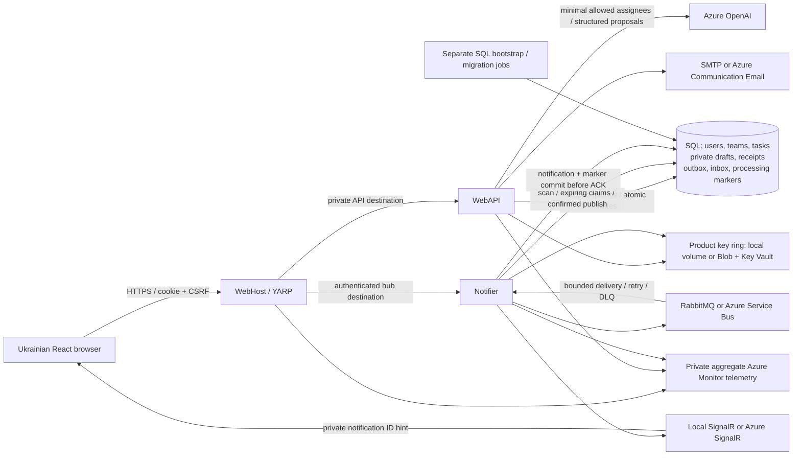

# Product architecture

The browser uses one HTTPS origin. WebHost proxies product API and authenticated
hub requests; it has no business database, cookie key-ring or email permissions.
API and Notifier validate current SQL membership and share only TaskManager's
Data Protection application name and key ring. Legacy JWT clients remain supported.

## Writes and recovery

Extraction creates a private, expiring draft. The owner reviews sources, edits
fields and chooses rows. Commit revalidates current access/version/expiry and
atomically writes tasks, draft-item links, idempotency receipt and outbox intent.
SQL unique constraints protect concurrent materialization. A repeated identical
commit returns its receipt; changed content with the same key conflicts.

Notifier owns scans, dispatch and cleanup. Expiring SQL leases coordinate
replicas; sent timestamps follow broker confirmation. The consumer atomically
commits inbox plus processing marker, then settles the broker delivery, then
sends an optional private hint. SQL history repairs offline/reconnect gaps;
network delivery remains at least once. Stored names do not bypass current
membership checks, and hints contain no task text or client-selected group.

## Deployment and evidence

Azure uses distinct web/API/notifier identities and separate bootstrap/migrator
identities. The migration job completes before candidate workers start. A
candidate with zero HTTP weight can still consume; rollback explicitly stops it.
Schema rollback is a separate reviewed restore/forward-repair procedure.

See [Azure delivery](azure-deployment.md), [notification guarantees](notifications.md)
and the authoritative [roadmap](../AI/plan.md). Offline SDK fixtures, controlled
full-stack tests, actual SQL/RabbitMQ CI and live Azure/model evidence are distinct
verification scopes. Controlled fixtures cannot authorize cloud traffic promotion.
